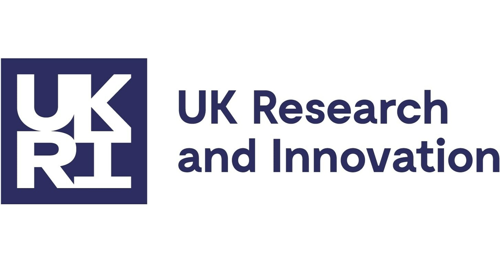

```{=html}
<style>
/* Page-level styling of the About page */
.partner-list ul {
  columns: 2 16rem;
  column-gap: 2rem;
  padding-left: 1.1rem;
}
.partner-list li {
  break-inside: avoid;
  margin-bottom: 0.2rem;
}
.funding-logos {
  display: flex;
  flex-wrap: wrap;
  align-items: center;
  gap: 1.5rem 2.5rem;
  margin: 1.5rem 0 1.8rem 0;
}
.funding-logos p,
.funding-logos figure,
.funding-logos .quarto-figure {
  margin: 0;
}
.funding-logos img {
  height: 56px;
  width: auto;
  max-width: 100%;
}
.disclaimer {
  color: var(--ip-muted);
  font-size: 0.92rem;
}
.citation {
  border-top: 1px solid var(--ip-rule);
  border-bottom: 1px solid var(--ip-rule);
  padding: 0.9rem 0 0.1rem 0;
  margin: 1rem 0 1.4rem 0;
  font-size: 0.95rem;
}
</style>
```

## The IP-PAD project

IP-PAD, short for Interdisciplinary Perspectives on the Politics of Adolescence and Democracy, is a Doctoral Network funded by the European Union under the Marie Skłodowska-Curie Actions. It studies how the cognitive, emotional and social changes of adolescence and early adulthood shape the way young people process political information and engage with politics.

As part of this work, the network surveys young people in Austria, Greece, the Netherlands, Poland and the United Kingdom, using a common set of questions and inviting respondents back in later waves. This website presents the UK data, which were collected by the team at Royal Holloway, University of London, with fieldwork by Gallup International and Survation. The [data page](data.qmd) describes how the surveys were carried out.

## Partners

The network is formed by five universities.

::: {.partner-list}
- University of Amsterdam, Netherlands
- University of Vienna, Austria
- Panteion University of Social and Political Sciences, Greece
- Jagiellonian University, Poland
- Royal Holloway, University of London, United Kingdom
:::

More about the network and its other work is available at [www.ippad.eu](https://www.ippad.eu).

## This website and the combined data

The combined UK data file and this website were prepared by Olaf Borghi at Royal Holloway, University of London. Questions about either are welcome at olaf.borghi@rhul.ac.uk ([send an email](mailto:olaf.borghi@rhul.ac.uk)).

## Funding {#funding}

This research was conducted as part of the Interdisciplinary Perspectives on the Politics of Adolescence and Democracy (IP-PAD) Doctoral Network. IP-PAD is funded by the European Union, under the Horizon Europe MSCA Doctoral Networks programme (Call HORIZON-MSCA-2021-DN-01, Grant Agreement No. 101072992) with participation from the UKRI Horizon Europe guarantee scheme UKRI EPSRC EP/X026825/1.

::: {.funding-logos}
{fig-alt="Funded by the European Union, logo of the European Commission"}

{fig-alt="Logo of UK Research and Innovation (UKRI)"}
:::

::: {.disclaimer}
Views and opinions expressed are those of the author(s) only and do not necessarily reflect those of the European Union, the European Research Executive Agency or UKRI. Neither the European Union nor the granting authorities can be held responsible for them.
:::

## Citation and licence {#citation}

::: {.citation}
Smets, K., Arahal, I., Bakker, B.N., Barkas, D., Borghi, O., Chryssochoou X., Couto de Jesus, G., Kasper, J., Kegel, J., Knorr, A., Kossowska M., Kovalov, N., Kritzinger, S., Laffineur C., Lamm C., Liao, Y., Mazur, L., Nika, C., Niraki, M., Perek-Bialas, J., Schumacher, G., Seremeta, E., Silani, G., Tsakiris, M., Vatakis, A., Wagner, M., Wichary, S. (2026) 'IP-PAD Waves 1 and 2: Combined data, Gallup International and Survation – United Kingdom' \[24/5/2024–1/11/2026\], Version 1.0.
:::

The data, their documentation and the text of this website are released under a [CC BY 4.0](https://creativecommons.org/licenses/by/4.0/) licence, so you may share and adapt them for any purpose if you cite the data as above and indicate any changes.
